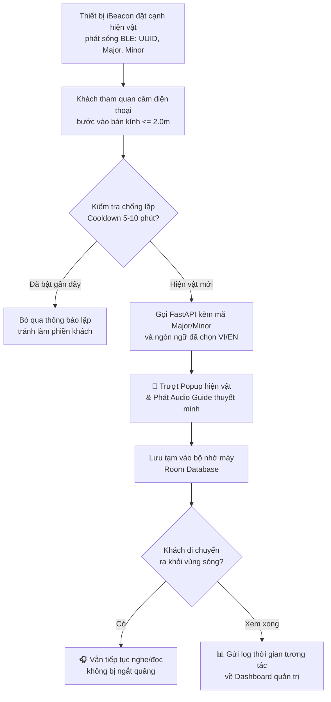
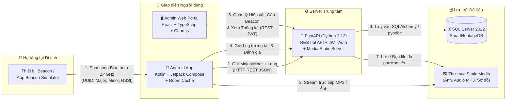
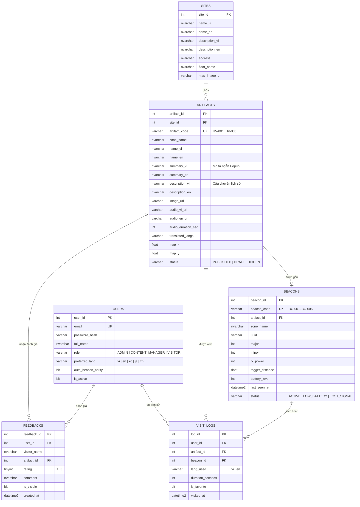
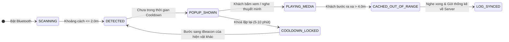

# 🏛️ Smart Heritage

> Hệ thống du lịch thông minh ứng dụng công nghệ **iBeacon (Bluetooth Low Energy)** giúp tự động nhận diện khoảng cách của khách tham quan với hiện vật lịch sử, phát thuyết minh đa ngôn ngữ và hỗ trợ ban quản lý số hóa, thống kê dữ liệu di tích.

-3DDC84)
-009688)


---

## 1. Vấn đề và hướng giải quyết

Tại nhiều bảo tàng và khu di tích lịch sử ở Việt Nam, việc tiếp cận thông tin hiện vật vẫn còn nhiều rào cản:

| Vấn đề | Hậu quả |
|---|---|
| Bảng thông tin tĩnh và chỉ có tiếng Việt | Khách tham quan (đặc biệt là khách quốc tế và giới trẻ) tiếp nhận thụ động, khó hiểu sâu câu chuyện lịch sử |
| Quét mã QR thủ công ở từng hiện vật | Làm đứt mạch cảm xúc tham quan, bất tiện khi thiếu sáng hoặc đông người |
| Ban quản lý thiếu công cụ số hóa và đo lường | Không biết hiện vật nào được quan tâm nhất, khách dùng ngôn ngữ nào hay thời gian dừng chân bao lâu |

**Smart Heritage loại bỏ thao tác quét mã thủ công.** Thay vào đó, luồng trải nghiệm tự động của hệ thống là:

```text
Approach  -->  Detect (BLE)  -->  Resolve  -->  Experience  -->  Cache  -->  Analyze
Tiếp cận       Bắt sóng iBeacon   Tra cứu       Nghe/Xem         Lưu tạm     Thống kê
hiện vật       dưới 2.0 mét       đa ngữ        thuyết minh      xem tiếp    lượt tương tác
```

### Luồng tự động nhận diện iBeacon và thuyết minh (điểm đặc trưng)



> Hệ thống **tự động chống lặp thông báo (Duplicate Prevention)**: Khi khách đứng yên ngắm một hiện vật, ứng dụng chỉ bật gợi ý một lần duy nhất và chỉ kích hoạt lại khi khách bước sang vùng phủ sóng của hiện vật khác.

---

## 2. Tính năng (phạm vi MVP trong 1 tháng)

| Nhóm | Chức năng |
|---|---|
| 👤 Tài khoản & Đa ngữ | Đăng ký / đăng nhập bằng email + password, chế độ **Khách vãng lai (Guest)** không cần đăng nhập, cập nhật hồ sơ, chọn ngôn ngữ thuyết minh (**Tiếng Việt / Tiếng Anh**), phân quyền `ADMIN` / `CONTENT_MANAGER` / `VISITOR` |
| 📡 Nhận diện iBeacon | Quét tín hiệu Bluetooth Low Energy (BLE) liên tục, ước lượng khoảng cách từ chỉ số RSSI, tự động bật **Bottom Sheet Popup** trong vòng $< 2\text{ s}$ khi cách hiện vật $\le 2.0\text{ m}$, chặn thông báo trùng lặp |
| 🎧 Đa phương tiện & Offline | Xem mô tả ngắn (`summary`), câu chuyện lịch sử chi tiết (`description`), bộ sưu tập ảnh và trình phát **Audio Guide (`.mp3`)** theo ngôn ngữ đã chọn; tự động lưu đệm (Cache) để khách rời khỏi vùng sóng iBeacon vẫn nghe/đọc tiếp trọn vẹn |
| 🗺️ Bản đồ di tích | Hiển thị sơ đồ mặt bằng khu di tích với các điểm ghim (Pin) vị trí hiện vật; làm nổi bật vị trí hiện vật khách đang đứng gần; chạm vào ghim để xem thông tin |
| ❤️ Yêu thích & Lịch sử | Lưu hiện vật yêu thích (Favorites), xem lại nhật ký các hiện vật đã đi qua (Visit History) |
| ⭐ Đánh giá & Phản hồi | Chấm điểm $1\text{--}5$ sao và gửi nhận xét cho từng hiện vật; Admin kiểm duyệt (hiển thị / ẩn) phản hồi trên Web |
| 🛠️ Quản trị CMS & iBeacon | Quản lý khu di tích, thêm/sửa/xóa hiện vật đa ngôn ngữ (`HV-001`...), tải lên file ảnh/MP3; đăng ký mã iBeacon (`BC-001`..., `UUID`, `Major`, `Minor`), gán iBeacon vào hiện vật và chấm tọa độ $(X, Y)$ lên sơ đồ |
| 📊 Thống kê & Báo cáo | Dashboard trực quan hóa tổng lượt khách, biểu đồ Top hiện vật phổ biến, lượt tương tác theo ngày, tỷ lệ ngôn ngữ sử dụng và xuất báo cáo **Excel (`.xlsx`) / PDF** |

---

## 3. Kiến trúc tổng quan và cách các công nghệ kết nối



### Quy tắc kết nối giữa các thành phần (dễ nhớ)

> **iBeacon chỉ phát mã số qua Bluetooth $\rightarrow$ App Android bắt mã số đó hỏi FastAPI $\rightarrow$ FastAPI tra bảng SQL Server trả về nội dung và link thuyết minh MP3.**

| Việc cần làm | Đi đường nào | Vì sao |
|---|---|---|
| Phát tín hiệu vị trí hiện vật | `iBeacon` $\rightarrow$ `Android App` (qua sóng Bluetooth BLE) | Cục iBeacon chỉ phát quảng bá 1 chiều (`UUID`, `Major`, `Minor`), không cần mạng Internet |
| Biết cục iBeacon đó là hiện vật gì | `Android App` $\rightarrow$ `FastAPI` (`GET /api/beacons/resolve`) | App gửi `Major`, `Minor` và ngôn ngữ (`vi`/`en`) lên Server để lấy đúng bài viết, ảnh và link MP3 |
| Nghe thuyết minh & xem ảnh | `Android App` $\rightarrow$ `FastAPI Static Media` (`/static/...`) | Tải ảnh và phát trực tiếp (stream) file `.mp3` qua trình phát `ExoPlayer` |
| Xem tiếp khi đã đi xa hiện vật | `Android App` $\rightarrow$ `Room Database` (Bộ nhớ trong điện thoại) | Nội dung vừa mở được lưu tạm trên máy, mất sóng Bluetooth vẫn nghe tiếp đến hết bài |
| Ghi nhận lượt khách & thời gian xem | `Android App` $\rightarrow$ `FastAPI` (`POST /api/visit-logs`) | Khi khách rời hiện vật, App gửi số giây đã xem lên Server để cộng vào biểu đồ thống kê |
| Thêm hiện vật, tải MP3 & gán Beacon | `Admin Web` $\rightarrow$ `FastAPI` $\rightarrow$ `SQL Server` | Giúp ban quản lý cập nhật nội dung mới từ trình duyệt mà không cần sửa code ứng dụng di động |
| Xem biểu đồ & xuất báo cáo Excel/PDF | `Admin Web` $\rightarrow$ `FastAPI` (`GET /api/analytics/dashboard`) | Server tổng hợp dữ liệu bằng các câu lệnh `GROUP BY` từ SQL Server trả về cho Web vẽ biểu đồ |

---

## 4. Công nghệ sử dụng & Phiên bản cần thiết

> ⚠️ **Lưu ý bắt buộc cho các thành viên trong nhóm:** Để tránh lỗi xung đột thư viện hoặc lỗi thiếu trình biên dịch C++/Rust khi cài đặt, các thành viên cần cài đặt **đúng phiên bản phần mềm** được quy định dưới đây.

### 🛠️ Phần mềm nền tảng cần cài đặt trên máy

| Phần mềm / Công cụ | Phiên bản bắt buộc / Khuyên dùng | Thành viên cần cài | Lưu ý quan trọng khi cài đặt |
|---|---|---|---|
| **Python** | **Python 3.12.x (64-bit)** *(Khuyên dùng `3.12.10`)* | Cả nhóm (đặc biệt TV1, TV3, TV4) | **TUYỆT ĐỐI KHÔNG dùng Python 3.14 hoặc 3.15** (chưa có gói `.whl` cho `pyodbc` và `pydantic-core`). Khi chạy bộ cài `.exe` trên Windows, bắt buộc tích chọn **"Add python.exe to PATH"**. Không dùng Python đi kèm MSYS2 (`ucrt64`). |
| **SQL Server & SSMS** | **Microsoft SQL Server 2019 / 2022** (Developer hoặc Express) + **SSMS 19 / 20** | Cả nhóm | Khi cài SSMS sẽ tự động cài sẵn `ODBC Driver 17/18 for SQL Server` để Python kết nối. |
| **Node.js** | **Node.js 20.x LTS** (hoặc `18.x LTS`) | TV3, TV4 (Admin Web) | Tải bản Windows Installer (`.msi`), kiểm tra sau khi cài bằng lệnh `node -v` và `npm -v`. |
| **Android Studio** | **Android Studio Koala / Ladybug (2024.x+)** + **JDK 17** | TV2, TV1 (Mobile) | Cần `Android SDK 34`, 1 điện thoại Android thật để quét Bluetooth và 1 điện thoại phụ cài app **Beacon Simulator**. |
| **Git & VS Code** | Bản mới nhất | Cả 5 thành viên | Dùng để quản lý mã nguồn Git và lập trình Backend / Web. |

### ⚙️ Backend (Python 3.12 – `backend/requirements.txt`)

| Mục đích | Thư viện | Phiên bản chuẩn |
|---|---|---|
| Framework RESTful API | `fastapi` | `0.115.0` (Tự động sinh tài liệu OpenAPI / Swagger tại `/docs`) |
| ASGI Server chạy ứng dụng | `uvicorn[standard]` | `0.30.6` (Hỗ trợ tự động tải lại khi sửa code với cờ `--reload`) |
| Kết nối & Truy vấn CSDL | `sqlalchemy` | `2.0.35` |
| Driver kết nối SQL Server | `pyodbc` | `5.1.0` |
| Kiểm tra dữ liệu (Validation) | `pydantic` | `2.9.2` (`pydantic-core==2.23.4`) |
| Quản lý biến môi trường `.env` | `python-dotenv` | `1.0.1` |
| Upload file Ảnh & Audio MP3 | `python-multipart` | `0.0.12` |

### 📱 Mobile (Android)

| Mục đích | Công nghệ & Phiên bản |
|---|---|
| Ngôn ngữ / Giao diện | `Kotlin 1.9+`, `Jetpack Compose`, `Material 3` (`Min SDK 26 - Android 8.0`, `Target SDK 34`) |
| Kiến trúc | MVVM (`UI` $\rightarrow$ `ViewModel` $\rightarrow$ `Repository`), `Kotlin Coroutines` + `StateFlow` |
| Quét sóng iBeacon (BLE) | `Android Beacon Library (org.altbeacon:android-beacon-library:2.20+)` |
| Giả lập thiết bị phát iBeacon | Ứng dụng `Beacon Simulator` trên điện thoại Android phụ |
| Phát thuyết minh Audio / Video | `AndroidX Media3 (ExoPlayer 1.3+)` |
| Lưu đệm xem ngoài vùng sóng | `Room Database 2.6+ (SQLite)` + `Preferences DataStore` |
| Gọi REST API & Hiển thị ảnh | `Retrofit 2.11+` + `OkHttp 4.12+` + `Coil Compose 2.6+` |

### 🗄️ Cơ sở dữ liệu

| Mục đích | Công nghệ & Phiên bản |
|---|---|
| Hệ quản trị CSDL | `Microsoft SQL Server 2019 / 2022` (Database: `SmartHeritageDB`) |
| Công cụ quản trị & Thiết kế | `SQL Server Management Studio (SSMS 19/20)` |
| Driver kết nối từ Backend | `ODBC Driver 17 for SQL Server` hoặc `ODBC Driver 18 for SQL Server` |

### 🖥️ Admin Web

| Mục đích | Công nghệ & Phiên bản |
|---|---|
| Framework & Build Tool | `React 18.x` + `Vite 5.x` + `TypeScript 5.x` |
| Thư viện giao diện CMS | `Ant Design 5.x` / `Tailwind CSS 3.x` |
| Biểu đồ thống kê Dashboard | `Chart.js 4.x` / `Recharts 2.x` |
| Gọi API & Xuất báo cáo | `Axios 1.7+` + `SheetJS (xlsx)` |

---

## 5. Thiết kế cơ sở dữ liệu

Schema gồm **6 bảng cốt lõi** trong SQL Server (`database/init_schema.sql`), đồng bộ 100% với thiết kế Figma Web Admin (`W1`–`W8`) và Mobile App (`M1`–`M10`).



### Trạng thái nhận diện iBeacon trên thiết bị di động



---

## 6. Cơ chế kỹ thuật & Bảo mật: những điểm chính

- **Bộ thông số iBeacon chuẩn hóa toàn dự án:**
  - `UUID` dùng chung: `FDA50693-A4E2-4FB1-AFCF-C6EB07647825`
  - `Major`: `1` (Khu di tích số 1)
  - `Minor`: `101`, `102`, `103`, `104`, `105` (Tương ứng với 5 hiện vật mẫu `HV-001` $\rightarrow$ `HV-005` và mã thiết bị `BC-001` $\rightarrow$ `BC-005`).
- **Lọc nhiễu tín hiệu BLE & Chống lặp thông báo:** Sóng Bluetooth rất dễ dao động; ứng dụng kết hợp kiểm tra ngưỡng khoảng cách kích hoạt (`trigger_distance` $\le 2.0\text{ m}$) và biến khóa thời gian (`Cooldown Timer`) để không bao giờ bật thông báo lặp lại làm phiền khách khi họ vẫn đứng tại cùng một hiện vật.
- **Xem liên tục ngoài vùng phủ sóng:** Ngay khi hiện vật được kích hoạt, nội dung văn bản và đường dẫn âm thanh được lưu vào `Room Database` trên điện thoại, giúp khách vừa đi dạo sang khu vực khác vừa nghe hết bài thuyết minh.
- **Tự động chuyển đổi đa ngôn ngữ:** Dựa trên cờ ngôn ngữ (`lang` = `vi` hoặc `en`) của khách, API tự động trả về tiêu đề, mô tả ngắn, câu chuyện lịch sử và file âm thanh `.mp3` tương ứng.
- **Giám sát tình trạng iBeacon thụ động (Passive Telemetry):** Mỗi khi điện thoại của khách tham quan quét thấy iBeacon và gọi API `/api/beacons/resolve`, hệ thống tự động cập nhật cột `last_seen_at` của thiết bị đó để Admin theo dõi trên Web.
- **Bảo mật & Phân quyền (RBAC):** Hệ thống phân tách rõ 3 vai trò `ADMIN`, `CONTENT_MANAGER` và `VISITOR`.

---

## 7. Giao diện (thiết kế Figma)

Thiết kế gồm **10 màn hình Mobile (`M1`–`M10`)** và **8 màn hình Web Admin (`W1`–`W8`)**:

| Nhóm màn hình | Nội dung |
|---|---|
| **Mobile: Khởi động & Tài khoản (`M1`, `M2`, `M3`)** | `1.` Chào mừng và chọn ngôn ngữ (Việt / Anh), `2.` Đăng nhập (có nút **Tiếp tục với tư cách Khách - Guest**), `3.` Tạo tài khoản mới |
| **Mobile: Trang chủ & Rada BLE (`M4`, `M5`)** | `4.` Trang chủ và Rada dò sóng iBeacon + danh sách hiện vật nổi bật, `5.` **Popup tự động** trượt lên khi tới gần hiện vật ($\le 2.0\text{ m}$) |
| **Mobile: Trải nghiệm Hiện vật (`M6`, `M8`)** | `6.` Chi tiết hiện vật, trình phát **Audio Guide MP3**, câu chuyện lịch sử và nhãn báo đã lưu tạm; `8.` Hộp thoại chấm sao và chia sẻ cảm nhận |
| **Mobile: Bản đồ, Đã lưu & Cá nhân (`M7`, `M9`, `M10`)** | `7.` Bản đồ tương tác sơ đồ mặt bằng có ghim hiện vật, `9.` Yêu thích & Lịch sử tham quan (2 Tabs), `10.` Hồ sơ cá nhân & công tắc bật/tắt thông báo tự động iBeacon |
| **Admin Web: Quản trị CMS (`W1`, `W3`, `W4`)** | `W1.` Đăng nhập quản trị, `W3.` Quản lý hiện vật (`HV-001`...), `W4.` Thêm/Sửa hiện vật đa ngôn ngữ và tải file Ảnh + MP3 |
| **Admin Web: Hạ tầng iBeacon (`W5`, `W6`)** | `W5.` Quản lý thiết bị iBeacon (`BC-001`..., trạng thái hoạt động/pin yếu/mất tín hiệu), `W6.` Bản đồ vị trí iBeacon & chấm tọa độ lên sơ đồ khu di tích |
| **Admin Web: Thống kê & Hệ thống (`W2`, `W7`, `W8`)** | `W2.` Thống kê & xuất báo cáo (Top hiện vật, Lượt khách theo ngày, Ngôn ngữ, xuất Excel/PDF), `W7.` Kiểm duyệt đánh giá & phản hồi, `W8.` Quản lý ngôn ngữ & tài khoản |

---

## 8. Cấu trúc repository

Cấu trúc thư mục được chuẩn hóa xuyên suốt từ cột mốc **M0 đến M8**, chỉ tập trung vào các thành phần cốt lõi của 4 phân hệ (`database`, `backend`, `mobile`, `admin-web`):

```text
SmartHeritage/
├── database/
│   └── init_schema.sql          # Script tạo 6 bảng SQL Server & nạp sẵn dữ liệu mẫu (M0)
├── backend/                     # Server RESTful API (Python 3.12 + FastAPI)
│   ├── app/
│   │   ├── database.py          # Kết nối SQL Server qua SQLAlchemy & pyodbc (M0)
│   │   ├── schemas.py           # Khai báo kiểu dữ liệu Request/Response Pydantic (M1-M7)
│   │   ├── auth.py              # Xử lý đăng ký, đăng nhập, JWT & phân quyền (M1)
│   │   └── main.py              # Khởi chạy FastAPI & định nghĩa các Endpoint API (M0-M7)
│   ├── static/                  # Lưu trữ file đa phương tiện phục vụ qua HTTP (M0, M2, M5)
│   │   ├── images/              # Ảnh đại diện hiện vật (HV-001..) & sơ đồ mặt bằng
│   │   └── audio/               # File âm thanh thuyết minh đa ngôn ngữ (.mp3)
│   └── requirements.txt         # Danh sách các thư viện Python 3.12 của Backend
├── mobile/                      # Ứng dụng Android (Kotlin + Jetpack Compose)
│   └── app/src/main/java/com/smartheritage/
│       ├── ble/                 # Bộ quét sóng iBeacon (AltBeacon) & lọc chống lặp (M4)
│       ├── data/                # Retrofit API Client & Room Database lưu đệm Offline (M5, M6)
│       ├── ui/                  # Giao diện 10 màn hình Compose (M1-M10) & trình phát ExoPlayer
│       └── viewmodel/           # Quản lý trạng thái giao diện theo kiến trúc MVVM
├── admin-web/                   # Cổng quản trị Web (React + Vite + TypeScript)
│   └── src/
│       ├── pages/               # Giao diện 8 màn hình quản trị (W1-W8) (M1-M3, M7)
│       ├── components/          # Biểu đồ thống kê, Bản đồ tọa độ & Form Upload Media
│       └── services/            # Cấu hình Axios kết nối RESTful API với Backend
├── docs/                        # Báo cáo SRS/SDD, Biểu đồ thiết kế & Tài liệu hướng dẫn (M8)
└── README.md
```

---

## 9. Hướng dẫn cài đặt & Khởi chạy chi tiết (Áp dụng cho mọi máy trong nhóm)

Mọi thành viên trong nhóm sau khi `git clone` dự án về máy chỉ cần làm đúng theo thứ tự **4 bước** dưới đây là hệ thống sẽ hoạt động ngay mà không gặp lỗi môi trường:

### Bước 1: Khởi tạo Cơ sở dữ liệu trên SQL Server (SSMS)

1. Mở phần mềm **SQL Server Management Studio (SSMS)** và kết nối vào SQL Server trên máy của bạn.
   * 📌 **Ghi nhớ tên `Server name`** lúc đăng nhập SSMS (thường là `localhost`, `.`, hoặc `.\SQLEXPRESS`).
2. Trên thanh menu của SSMS, chọn **File** $\rightarrow$ **Open** $\rightarrow$ **File...** và chọn file **`database/init_schema.sql`** trong thư mục dự án.
3. Nhấn phím **`F5` (Execute)**.
   * Script sẽ tự động tạo Database **`SmartHeritageDB`**, khởi tạo đủ **6 bảng** và nạp sẵn dữ liệu mẫu gồm 5 tài khoản, 5 hiện vật lịch sử (`HV-001` $\rightarrow$ `HV-005`) và 5 thiết bị iBeacon (`BC-001` $\rightarrow$ `BC-005`).

### Bước 2: Thiết lập Môi trường ảo Python 3.12 & Cài đặt Thư viện Backend

1. Đảm bảo máy đã cài đặt **Python 3.12 (64-bit)** từ [python.org/downloads/windows](https://www.python.org/downloads/windows/) và đã tích chọn **"Add python.exe to PATH"**.
   * *Mẹo kiểm tra:* Nếu máy có cài MSYS2 (`ucrt64`) hoặc bản Python khác, hãy luôn dùng lệnh `py -3.12` dưới đây để gọi đúng Python 3.12 chuẩn của Windows.
2. Mở Terminal (PowerShell) trong VS Code và chạy lần lượt từng lệnh sau:

```powershell
# 1. Di chuyển vào thư mục backend
cd backend

# 2. Tạo môi trường ảo (.venv) bằng đúng Python 3.12 chuẩn Windows
py -3.12 -m venv .venv

# 3. Mở quyền chạy script tạm thời cho cửa sổ PowerShell hiện tại
Set-ExecutionPolicy -Scope Process -ExecutionPolicy Bypass

# 4. Kích hoạt môi trường ảo (Đầu dòng lệnh sẽ xuất hiện chữ (.venv) màu xanh)
.\.venv\Scripts\Activate.ps1

# 5. Cài đặt toàn bộ thư viện trong requirements.txt
pip install -r requirements.txt
```

> 💡 **Ghi chú:**
> - Nếu bạn dùng cửa sổ **Command Prompt (`cmd`)**, ở lệnh số 4 chỉ cần gõ: `.venv\Scripts\activate`
> - Khi muốn tắt môi trường ảo, chỉ cần gõ lệnh: `deactivate`

### Bước 3: Cấu hình file `.env` và Khởi chạy Server FastAPI

1. Trong thư mục **`backend/`**, tạo một file mới tên là **`.env`** với nội dung sau:

```env
USE_WINDOWS_AUTH=true
DB_SERVER=.\SQLEXPRESS
DB_NAME=SmartHeritageDB

# Chỉ cần dùng 2 dòng dưới nếu máy bạn tắt Windows Auth (USE_WINDOWS_AUTH=false)
DB_USER=sa
DB_PASSWORD=your_password_here
```

*(Thay giá trị `DB_SERVER` bằng đúng tên `Server name` trên SSMS của máy bạn, ví dụ `DB_SERVER=localhost` hoặc `DB_SERVER=.\SQLEXPRESS`).*

2. Tại cửa sổ Terminal đang bật `(.venv)` trong thư mục `backend`, chạy lệnh khởi động Server:

```powershell
uvicorn app.main:app --host 0.0.0.0 --port 8000 --reload
```

3. **Kiểm tra xác nhận trên trình duyệt:**
   * Truy cập **`http://localhost:8000/docs`**: Giao diện tài liệu **Swagger UI** hiện ra đầy đủ các API.
   * Truy cập **`http://localhost:8000/api/health-db`**: Trả về `"status": "CONNECTED"` và `"total_artifacts": 5` là Backend đã kết nối SQL Server thành công.
   * Truy cập **`http://localhost:8000/api/beacons/resolve?major=1&minor=101&lang=vi`**: Trả về JSON thông tin hiện vật **Trống đồng Ngọc Lũ (`HV-001`)**.

### Bước 4: Khởi chạy Admin Web & Mobile App (Khi ghép nối Frontend)

1. **Admin Web (`admin-web/`)**:
   ```powershell
   cd admin-web
   npm install
   npm run dev
   ```
2. **Mobile App (`mobile/`) & Giả lập sóng iBeacon**:
   * Mở thư mục `mobile/` bằng **Android Studio**, điền địa chỉ IPv4 LAN của laptop chạy Backend (xem bằng lệnh `ipconfig`, ví dụ `http://192.168.1.10:8000`) vào `ApiClient.kt` rồi chạy ứng dụng lên **Điện thoại 1**.
   * Trên **Điện thoại 2**, mở ứng dụng **Beacon Simulator**, tạo cấu hình phát iBeacon với `UUID = FDA50693-A4E2-4FB1-AFCF-C6EB07647825`, `Major = 1`, `Minor = 101` và đặt gần Điện thoại 1 để kiểm thử tính năng tự động bật Popup và phát thuyết minh.

---

## 10. Lộ trình (Hoàn thành trong 1 tháng - 30 ngày)

- [x] **M0** Nền tảng (Ngày 1–3): Khởi tạo repo, đồng bộ thiết kế Figma, tạo CSDL SQL Server (`init_schema.sql`), chuẩn bị dữ liệu mẫu & khung FastAPI
- [ ] **M1** Tài khoản & Đa ngôn ngữ (Ngày 4–6): Đăng ký, đăng nhập, chế độ Khách (Guest), chọn ngôn ngữ (Việt/Anh), phân quyền Admin/Visitor
- [ ] **M2** Quản trị nội dung CMS (Ngày 7–10): Quản lý khu di tích, thêm/sửa/xóa hiện vật đa ngôn ngữ, upload ảnh & file thuyết minh MP3
- [ ] **M3** Hạ tầng iBeacon (Ngày 11–13): Đăng ký thiết bị iBeacon (`UUID`, `Major`, `Minor`), gán vào hiện vật, cấu hình bán kính & tọa độ sơ đồ
- [ ] **M4** Nhận diện iBeacon tự động (Ngày 14–18): Tích hợp quét sóng BLE trên Mobile, lọc khoảng cách $\le 2.0\text{ m}$, chống lặp thông báo & tự bật Popup
- [ ] **M5** Trải nghiệm Đa phương tiện & Bản đồ (Ngày 19–22): Trình phát Audio Guide/Video, lưu tạm xem tiếp ngoài vùng sóng (Cache) & bản đồ sơ đồ di tích
- [ ] **M6** Tương tác khách tham quan (Ngày 23–25): Lưu hiện vật yêu thích (Favorites), nhật ký lịch sử tham quan (Visit History), chấm sao & gửi đánh giá
- [ ] **M7** Thống kê & Quản trị nâng cao (Ngày 26–28): Dashboard biểu đồ lượt khách, Top hiện vật, ngôn ngữ, kiểm duyệt đánh giá & xuất báo cáo Excel/PDF
- [ ] **M8** Phát hành, Tài liệu & Demo (Ngày 29–30): Đồng bộ toàn hệ thống, hoàn thiện báo cáo Word (SRS/SDD), hướng dẫn sử dụng & quay video demo

---

## 11. Nhóm thực hiện

| Thành viên | Vai trò chính |
|---|---|
| **Phạm Gia Khiêm** (Leader - TV1) | Thiết kế CSDL SQL Server, phát triển Backend FastAPI & tích hợp hệ thống |
| **Thành viên 2** (TV2) | Phát triển ứng dụng di động Android (Kotlin, Jetpack Compose, Quét sóng BLE iBeacon) |
| **Thành viên 3** (TV3) | Phát triển Web Admin CMS (Quản lý di tích, hiện vật đa ngôn ngữ & cấu hình iBeacon) |
| **Thành viên 4** (TV4) | Phát triển Dashboard Thống kê, Biểu đồ báo cáo, Xuất Excel/PDF & Quản lý phản hồi |
| **Thành viên 5** (TV5) | Thiết kế giao diện Figma, chuẩn bị Dữ liệu mẫu (Việt/Anh, Audio MP3) & Tài liệu báo cáo |