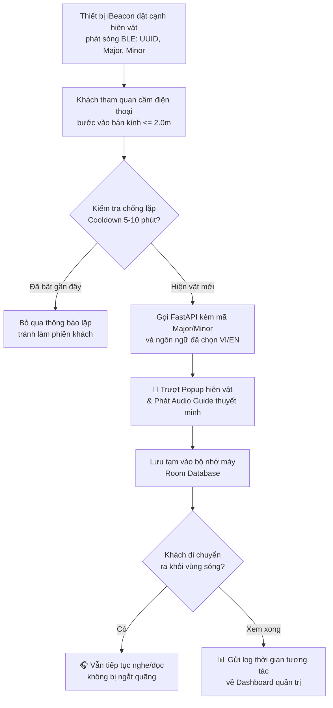
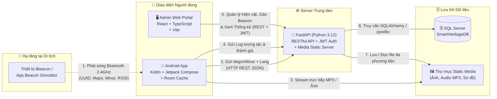
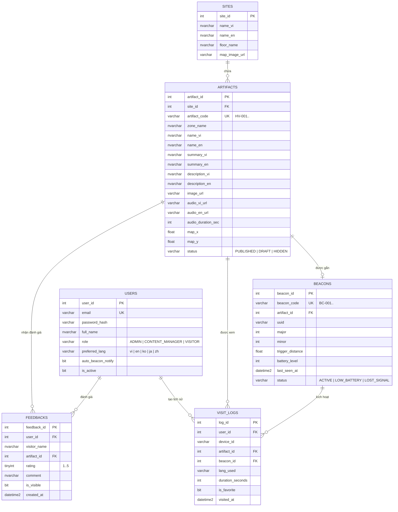

# 🏛️ Smart Heritage

> Hệ thống du lịch thông minh ứng dụng công nghệ **iBeacon (Bluetooth Low Energy)** giúp tự động nhận diện khoảng cách của khách tham quan với hiện vật lịch sử, phát thuyết minh đa ngôn ngữ và hỗ trợ ban quản lý số hóa, thống kê dữ liệu di tích.

-3DDC84)
-009688)


---

## 1. Vấn đề và hướng giải quyết

Tại nhiều bảo tàng và khu di tích lịch sử ở Việt Nam, việc tiếp cận thông tin hiện vật vẫn còn nhiều rào cản:

| Vấn đề | Hậu quả |
|---|---|
| Bảng thông tin tĩnh và chỉ có tiếng Việt | Khách tham quan (đặc biệt là khách quốc tế và giới trẻ) tiếp nhận thụ động, khó hiểu sâu câu chuyện lịch sử |
| Quét mã QR thủ công ở từng hiện vật | Làm đứt mạch cảm xúc tham quan, bất tiện khi thiếu sáng hoặc đông người |
| Ban quản lý thiếu công cụ số hóa và đo lường | Không biết hiện vật nào được quan tâm nhất, khách dùng ngôn ngữ nào hay thời gian dừng chân bao lâu |

**Smart Heritage loại bỏ thao tác quét mã thủ công.** Thay vào đó, luồng trải nghiệm tự động của hệ thống là:

```text
Approach  -->  Detect (BLE)  -->  Resolve  -->  Experience  -->  Cache  -->  Analyze
Tiếp cận       Bắt sóng iBeacon   Tra cứu       Nghe/Xem         Lưu tạm     Thống kê
hiện vật       dưới 2.0 mét       đa ngữ        thuyết minh      xem tiếp    lượt tương tác
```

### Luồng tự động nhận diện iBeacon và thuyết minh (điểm đặc trưng)



> Hệ thống **tự động chống lặp thông báo (Duplicate Prevention)**: Khi khách đứng yên ngắm một hiện vật, ứng dụng chỉ bật gợi ý một lần duy nhất và chỉ kích hoạt lại khi khách bước sang vùng phủ sóng của hiện vật khác.

---

## 2. Tính năng (phạm vi MVP trong 1 tháng)

| Nhóm | Chức năng |
|---|---|
| 👤 Tài khoản & Đa ngữ | Đăng ký / đăng nhập bằng email + password, chế độ **Khách vãng lai (Guest)** không cần đăng nhập, cập nhật hồ sơ, chọn ngôn ngữ thuyết minh (**Tiếng Việt / Tiếng Anh**), phân quyền `ADMIN` / `CONTENT_MANAGER` / `VISITOR` |
| 📡 Nhận diện iBeacon | Quét tín hiệu Bluetooth Low Energy (BLE) liên tục, ước lượng khoảng cách từ chỉ số RSSI, tự động bật **Bottom Sheet Popup** trong vòng $< 2\text{ s}$ khi cách hiện vật $\le 2.0\text{ m}$, chặn thông báo trùng lặp |
| 🎧 Đa phương tiện & Offline | Xem mô tả ngắn (`summary`), câu chuyện lịch sử chi tiết (`description`), bộ sưu tập ảnh, video và trình phát **Audio Guide (`.mp3`)** theo ngôn ngữ đã chọn; tự động lưu đệm (Cache) để khách rời khỏi vùng sóng iBeacon vẫn nghe/đọc tiếp trọn vẹn |
| 🗺️ Bản đồ di tích | Hiển thị sơ đồ mặt bằng khu di tích với các điểm ghim (Pin) vị trí hiện vật; làm nổi bật vị trí hiện vật khách đang đứng gần; chạm vào ghim để xem thông tin |
| ❤️ Yêu thích & Lịch sử | Lưu hiện vật yêu thích (Favorites), xem lại nhật ký các hiện vật đã đi qua (Visit History) hỗ trợ cả tài khoản đăng nhập và chế độ Guest |
| ⭐ Đánh giá & Phản hồi | Chấm điểm $1\text{--}5$ sao và gửi nhận xét cho từng hiện vật; Admin kiểm duyệt (hiển thị / ẩn) phản hồi trên Web |
| 🛠️ Quản trị CMS & iBeacon | Quản lý khu di tích, thêm/sửa/xóa hiện vật đa ngôn ngữ (`HV-001`...), tải lên file ảnh/MP3; đăng ký mã iBeacon (`BC-001`..., `UUID`, `Major`, `Minor`), gán iBeacon vào hiện vật và chấm tọa độ $(X, Y)$ lên sơ đồ |
| 📊 Thống kê & Báo cáo | Dashboard trực quan hóa tổng lượt khách, biểu đồ Top 10 hiện vật phổ biến, lượt tương tác theo ngày, tỷ lệ ngôn ngữ sử dụng và xuất báo cáo **Excel/CSV (`.csv`)** |

---

## 3. Kiến trúc tổng quan và cách các công nghệ kết nối



### Quy tắc kết nối giữa các thành phần (dễ nhớ)

> **iBeacon chỉ phát mã số qua Bluetooth** $\rightarrow$ **App Android bắt mã số đó hỏi FastAPI** $\rightarrow$ **FastAPI tra bảng SQL Server trả về nội dung và link thuyết minh MP3.**

| Việc cần làm | Đi đường nào | Vì sao |
|---|---|---|
| Phát tín hiệu vị trí hiện vật | `iBeacon` $\rightarrow$ `Android App` (qua sóng Bluetooth BLE) | Cục iBeacon chỉ phát quảng bá 1 chiều (`UUID`, `Major`, `Minor`), không cần mạng Internet |
| Biết cục iBeacon đó là hiện vật gì | `Android App` $\rightarrow$ `FastAPI` (`GET /api/beacons/resolve`) | App gửi `Major`, `Minor` và ngôn ngữ (`vi`/`en`) lên Server để lấy đúng bài viết, ảnh và link MP3 |
| Nghe thuyết minh & xem ảnh | `Android App` $\rightarrow$ `FastAPI Static Media` (`/static/...`) | Tải ảnh và phát trực tiếp (stream) file `.mp3` qua trình phát `ExoPlayer` |
| Xem tiếp khi đã đi xa hiện vật | `Android App` $\rightarrow$ `Room Database` (Bộ nhớ trong điện thoại) | Nội dung vừa mở được lưu tạm trên máy, mất sóng Bluetooth vẫn nghe tiếp đến hết bài |
| Ghi nhận lượt khách & thời gian xem | `Android App` $\rightarrow$ `FastAPI` (`POST /api/visit-logs`) | Khi khách rời hiện vật, App gửi số giây đã xem lên Server để cộng vào biểu đồ thống kê |
| Thêm hiện vật, tải MP3 & gán Beacon | `Admin Web` $\rightarrow$ `FastAPI` $\rightarrow$ `SQL Server` | Giúp ban quản lý cập nhật nội dung mới từ trình duyệt mà không cần sửa code ứng dụng di động |
| Xem biểu đồ & xuất báo cáo Excel/CSV | `Admin Web` $\rightarrow$ `FastAPI` (`GET /api/analytics/dashboard`) | Server tổng hợp dữ liệu bằng các câu lệnh `GROUP BY` từ SQL Server trả về cho Web hiển thị |

---

## 4. Công nghệ sử dụng & Phiên bản cần thiết

> ⚠️ **Lưu ý quan trọng cho các thành viên trong nhóm:** Để đảm bảo cài đặt thư viện thành công 100% trên mọi máy tính, các thành viên cần cài đặt đúng phiên bản phần mềm trong bảng dưới đây.

### 🛠️ Phần mềm nền tảng và Phiên bản bắt buộc

| Phần mềm / Công cụ | Phiên bản cần thiết | Thành viên cần cài | Lưu ý khi cài đặt |
|---|---|---|---|
| **Python** | **Python 3.12.x (64-bit)** *(Khuyên dùng `3.12.10`)* | TV1, TV3, TV4, TV5 | **Không dùng Python 3.14 hoặc 3.15** (vì chưa có sẵn gói wheel `.whl` cho `pyodbc` và `pydantic-core` trên Windows). Khi cài nhớ tích chọn **"Add python.exe to PATH"**. |
| **SQL Server & SSMS** | **SQL Server 2019 / 2022** (Developer hoặc Express) + **SSMS 19/20** | TV1, TV3, TV4, TV5 | Đi kèm sẵn `ODBC Driver 17/18 for SQL Server` để kết nối với Backend. |
| **Node.js** | **Node.js 20.x LTS** (hoặc `18.x / 22.x LTS`) | TV3, TV4 (Web Admin) | Dùng để chạy cổng quản trị React + Vite (`admin-web/`). |
| **Android Studio** | **Android Studio Koala / Ladybug (2024.x+)** + **JDK 17** | TV2, TV1 (Mobile) | Cần 1 điện thoại Android thật để quét Bluetooth và 1 điện thoại phụ cài app **Beacon Simulator**. |
| **Git & VS Code** | Bản mới nhất | Cả 5 thành viên | Quản lý nhánh theo mô hình `main` - `develop` - `feature/*`. |

### ⚙️ Backend (Python - Đã cấu hình trong `backend/requirements.txt`)

| Mục đích | Công nghệ & Phiên bản |
|---|---|
| Framework RESTful API | `fastapi==0.115.0` + `uvicorn[standard]==0.30.6` (Tự động sinh Swagger UI tại `/docs`) |
| Kết nối Cơ sở dữ liệu | `sqlalchemy==2.0.35` + `pyodbc==5.1.0` |
| Kiểm tra dữ liệu & Biến môi trường | `pydantic==2.9.2` + `python-dotenv==1.0.1` |
| Xác thực & Phân quyền | `HTTPBearer JWT (HS256)` + `SHA-256 Password Hashing` + `RBAC` (`app/auth.py`) |
| Upload & Phục vụ file Ảnh / MP3 | `python-multipart==0.0.12` + `FastAPI StaticFiles` |
| Xuất báo cáo thống kê | `StreamingResponse CSV (UTF-8-SIG BOM)` tương thích trực tiếp với Microsoft Excel |

### 🗄️ Cơ sở dữ liệu (`SmartHeritageDB` - Trọng tâm học phần Hệ quản trị CSDL)

| Mục đích | Kỹ thuật Hệ quản trị CSDL áp dụng |
|---|---|
| Kiến trúc 3 mức trừu tượng | Mức Vật lý (`Clustered / Non-Clustered Index`), Mức Luận lý (`6 bảng + Constraints`), Mức Khung nhìn (`vw_PublicArtifacts_VI_EN`, `vw_BeaconHealthMonitor`) |
| Quản lý Giao tác & Khóa (ACID) | `BEGIN TRAN ... COMMIT / ROLLBACK TRAN`, kiểm tra biến hệ thống `@@ERROR`, `@@ROWCOUNT`, `@@TRANCOUNT` |
| Chống 4 vấn đề truy xuất đồng thời | `READ COMMITTED` (chống *Dirty Read*), `REPEATABLE READ` (chống *Non-Repeatable Read*), `SERIALIZABLE` (chống *Phantom Read*), và `WITH (UPDLOCK)` (nâng cấp khóa `ULock` chống *Lost Update*) |
| Lập trình T-SQL nâng cao | Vòng lặp `WHILE + IF NOT EXISTS` cấp mã tự động (`sp_GenerateNextArtifactCode`), Con trỏ `CURSOR + @@FETCH_STATUS` (`sp_AuditBeaconHealth_Cursor`), cấu trúc rẽ nhánh `CASE ... WHEN` |

### 🖥️ Admin Web (`admin-web/`)

| Mục đích | Công nghệ |
|---|---|
| Framework & Build Tool | `React 19` + `Vite` + `TypeScript` |
| Kết nối RESTful API | `Fetch API` (`src/api.ts`) + Quản lý phiên đăng nhập JWT (`localStorage`) |
| Giao diện Quản trị | Khung điều hướng 8 màn hình (`W1`–`W8`), hỗ trợ Upload Ảnh/MP3 và chấm tọa độ $(X, Y)$ trực quan trên bản đồ |

---

## 5. Thiết kế cơ sở dữ liệu

Schema gồm **6 bảng cốt lõi**, **3 Non-Clustered Indexes**, **2 Views** và **7 Stored Procedures** trong SQL Server (`database/init_schema.sql`), đồng bộ 100% với thiết kế Figma Web (`W1`–`W8`) và Mobile (`1`–`10`).



---

## 6. Cơ chế kỹ thuật & Bảo mật: những điểm chính

- **Lọc nhiễu tín hiệu BLE & Chống lặp thông báo:** Sóng Bluetooth rất dễ dao động; ứng dụng kết hợp kiểm tra ngưỡng khoảng cách kích hoạt (`trigger_distance` $\le 2.0\text{ m}$) và biến khóa thời gian (`Cooldown Timer`) để không bao giờ bật thông báo lặp lại làm phiền khách khi họ vẫn đứng tại cùng một hiện vật.
- **Xem liên tục ngoài vùng phủ sóng:** Ngay khi hiện vật được kích hoạt, nội dung văn bản và đường dẫn âm thanh được lưu vào `Room Database` trên điện thoại, giúp khách vừa đi dạo sang khu vực khác vừa nghe hết bài thuyết minh.
- **Đảm bảo tính Nhất quán & Cô lập giao tác (ACID):** Các thao tác gán iBeacon, cập nhật tọa độ sơ đồ và cộng dồn thời gian tham quan được bảo vệ bằng giao tác `BEGIN TRAN ... COMMIT TRAN` kết hợp kỹ thuật nâng cấp khóa `WITH (UPDLOCK)` và các mức cô lập `READ COMMITTED`, `REPEATABLE READ`, `SERIALIZABLE`.
- **Bảo mật & Phân quyền (RBAC):** Xác thực người dùng bằng `HTTPBearer` JWT Token (`HS256`) và phân quyền 3 cấp độ: `ADMIN`, `CONTENT_MANAGER`, `VISITOR`.

---

## 7. Giao diện (thiết kế Figma)

Thiết kế gồm **10 màn hình Mobile (`1`–`10`)** và **8 màn hình Web Admin (`W1`–`W8`)**:

| Nhóm màn hình | Nội dung |
|---|---|
| **Mobile: Khởi động & Tài khoản (`1`–`3`)** | `1.` Chào mừng và chọn ngôn ngữ, `2.` Đăng nhập (hoặc *Tiếp tục với tư cách Khách*), `3.` Tạo tài khoản |
| **Mobile: Trang chủ & Rada BLE (`4`–`5`)** | `4.` Trang chủ và Rada dò iBeacon, `5.` Popup tự động trượt lên khi tới gần hiện vật |
| **Mobile: Trải nghiệm Hiện vật (`6`, `8`)** | `6.` Chi tiết hiện vật và Trình phát Audio Guide MP3, `8.` Hộp thoại Chia sẻ cảm nhận (chấm 1–5 sao) |
| **Mobile: Bản đồ & Cá nhân (`7`, `9`, `10`)** | `7.` Bản đồ tương tác sơ đồ di tích, `9.` Yêu thích và Lịch sử tham quan, `10.` Hồ sơ cá nhân & công tắc thông báo iBeacon |
| **Admin Web: Quản trị CMS (`W1`, `W3`, `W4`)** | `W1.` Đăng nhập quản trị, `W3.` Quản lý hiện vật, `W4.` Thêm/sửa hiện vật & đa ngôn ngữ (tải file Ảnh + MP3) |
| **Admin Web: Hạ tầng iBeacon (`W5`, `W6`)** | `W5.` Quản lý thiết bị iBeacon (`BC-001`...), `W6.` Bản đồ vị trí iBeacon & khu di tích |
| **Admin Web: Thống kê & Phản hồi (`W2`, `W7`, `W8`)** | `W2.` Thống kê & xuất báo cáo, `W7.` Kiểm duyệt đánh giá & phản hồi, `W8.` Quản lý ngôn ngữ & tài khoản |

---

## 8. Cấu trúc repository (Cập nhật theo tiến độ thực tế hiện tại)

> 📌 Cấu trúc dưới đây phản ánh **chính xác 100% các thư mục và file quan trọng đã được triển khai thực tế** trong repository:

```text
SmartHeritage/
├── admin-web/                       # Cổng quản trị Web (React + Vite + TypeScript)
│   ├── public/                      # Biểu tượng tĩnh của ứng dụng Web
│   ├── src/
│   │   ├── api.ts                   # Cấu hình kết nối HTTP & tự động đính kèm Bearer JWT Token gọi FastAPI
│   │   ├── App.tsx                  # Khung điều hướng và giao diện 8 màn hình quản trị (W1 -> W8)
│   │   ├── main.tsx                 # Điểm khởi chạy ứng dụng React DOM
│   │   └── index.css                # Định dạng CSS mặc định
│   ├── index.html                   # Trang HTML gốc của Vite
│   ├── package.json                 # Khai báo các gói thư viện và script chạy Web (dev, build)
│   ├── tsconfig.json                # Cấu hình trình biên dịch TypeScript
│   └── vite.config.ts               # Cấu hình Vite Dev Server
├── backend/                         # Server Python FastAPI
│   ├── app/
│   │   ├── routers/
│   │   │   ├── auth_router.py       # [M1] API Đăng nhập, Đăng ký, Guest, Hồ sơ & Quản lý Users (W1, W8, Mobile 1,2,3,10)
│   │   │   ├── artifact_router.py   # [M2] API Quản lý Hiện vật, Thống kê thẻ W3 & Upload Ảnh/MP3 (W3, W4, Mobile 4,6,7)
│   │   │   ├── beacon_router.py     # [M3] API Quản lý iBeacon, Thống kê thẻ W5 & Sơ đồ tọa độ di tích (W5, W6, Mobile 7)
│   │   │   └── analytics_router.py  # [M6-M7] API Lịch sử, Yêu thích, Đánh giá, Kiểm duyệt W7 & Dashboard Thống kê/CSV W2
│   │   ├── auth.py                  # [M1] Xử lý băm mật khẩu & tạo/kiểm tra HTTPBearer JWT Token
│   │   ├── database.py              # [M0] Tự động dò ODBC Driver & kết nối SQL Server
│   │   ├── main.py                  # [M0-M7] Khởi tạo FastAPI, CORS, Static Media, Health-DB, Resolve iBeacon & Gắn kết 4 Routers
│   │   └── schemas.py               # [M1-M7] Khuôn mẫu dữ liệu Pydantic cho toàn bộ các phân hệ
│   ├── static/
│   │   ├── audio/                   # [M0] 10 file thuyết minh âm thanh mẫu (.mp3) khớp với CSDL
│   │   └── images/                  # [M0] 5 ảnh hiện vật (hv_001..005.jpg) & sơ đồ mặt bằng (floorplan_tang1.png)
│   ├── .env.example                 # [M0] File mẫu cấu hình kết nối SQL Server cho các thành viên
│   ├── requirements.txt             # [M0] Danh sách thư viện Python chuẩn của Backend
│   └── seed_media.py                # Script tự động sinh bộ file ảnh & âm thanh mẫu trong static/
├── database/
│   └── init_schema.sql              # [M0] Script khởi tạo SmartHeritageDB (6 bảng, 3 Index, 2 View, 7 Stored Procedures & Seed Data)
├── .gitignore                       # [M0] Chặn .venv, __pycache__, .env, node_modules, dist, build
└── README.md                        # Tài liệu tổng quan và hướng dẫn cài đặt dự án
```

---

## 9. Hướng dẫn cài đặt và chạy dự án (Chuẩn hóa cho mọi máy trong nhóm)

Bất kỳ thành viên nào sau khi `git clone` dự án (hoặc `git pull origin develop`) về máy chỉ cần thực hiện đúng **3 bước** dưới đây:

### Bước 1: Khởi tạo Cơ sở dữ liệu trên SQL Server (SSMS)
1. Mở **SQL Server Management Studio (SSMS)** và kết nối vào Server của máy bạn.
   * *Ghi nhớ tên **Server name** ở màn hình đăng nhập SSMS (ví dụ: `.\SQLEXPRESS`, `localhost`, hoặc `TEN_MAY\SQLEXPRESS`).*
2. Chọn **File** $\rightarrow$ **Open** $\rightarrow$ **File...**, mở file **`database/init_schema.sql`** trong thư mục dự án.
3. Nhấn **`F5` (Execute)** để tạo CSDL `SmartHeritageDB` (bao gồm 6 bảng, 3 Indexes, 2 Views, 7 Stored Procedures xử lý giao tác đồng thời và dữ liệu mẫu).

---

### Bước 2: Thiết lập Môi trường ảo Python 3.12 & Khởi chạy Backend FastAPI (Terminal 1)
> **Yêu cầu:** Máy đã cài đặt **Python 3.12 (64-bit)** từ [python.org/downloads/windows](https://www.python.org/downloads/windows/) (có tích chọn *"Add python.exe to PATH"*).

Mở cửa sổ Terminal thứ nhất trong VS Code tại thư mục gốc dự án và chạy lần lượt:

```powershell
# 1. Di chuyển vào thư mục backend
cd backend

# 2. Tạo môi trường ảo chuẩn Windows bằng Python 3.12
py -3.12 -m venv .venv

# 3. Cấp quyền chạy script trên PowerShell (nếu dùng CMD thì bỏ qua dòng này)
Set-ExecutionPolicy -Scope Process -ExecutionPolicy Bypass

# 4. Kích hoạt môi trường ảo (Nếu dùng CMD thì gõ: .venv\Scripts\activate)
.\.venv\Scripts\Activate.ps1

# 5. Cài đặt các thư viện trong requirements.txt
pip install -r requirements.txt

# 6. Tạo bộ ảnh và âm thanh mẫu vào thư mục static/ (nếu chưa có)
python seed_media.py
```
*(Khi cần thoát khỏi môi trường ảo, chỉ cần gõ lệnh `deactivate`).*

Tiếp theo, tạo file **`backend/.env`** (copy từ `backend/.env.example`) và điền đúng tên `DB_SERVER` của máy bạn:
```env
USE_WINDOWS_AUTH=true
DB_SERVER=.\SQLEXPRESS
DB_NAME=SmartHeritageDB
```
Sau đó khởi chạy Server FastAPI (giữ cửa sổ Terminal này chạy ngầm):
```powershell
uvicorn app.main:app --host 0.0.0.0 --port 8000 --reload
```
* Kiểm tra Swagger UI tại: **`http://localhost:8000/docs`**
* Kiểm tra kết nối Database tại: **`http://localhost:8000/api/health-db`**

---

### Bước 3: Cài đặt & Khởi chạy Cổng Quản trị `admin-web` (Terminal 2)
> **Yêu cầu:** Máy đã cài đặt **Node.js (LTS)** từ [nodejs.org](https://nodejs.org/). Giữ nguyên Terminal 1 đang chạy FastAPI ở cổng `8000` để Web có thể lấy dữ liệu.

Mở một **cửa sổ Terminal thứ hai** trong VS Code (bấm dấu `+` ở góc phải khung Terminal) và chạy:

```powershell
# 1. Di chuyển vào thư mục admin-web đã có sẵn trong repo
cd admin-web

# 2. Cài đặt các gói thư viện Node.js (dùng cờ --legacy-peer-deps để tránh xung đột phiên bản linter)
npm install --legacy-peer-deps

# 3. Khởi chạy Vite Dev Server
npm run dev
```

* Mở trình duyệt truy cập địa chỉ hiển thị trên Terminal (mặc định là **`http://localhost:5173/`**).
* Đăng nhập tại màn hình **W1** bằng tài khoản Admin mẫu:
  * **Email:** `ngocanh@smartheritage.vn`
  * **Mật khẩu:** `123456`
* Trải nghiệm trực tiếp các màn hình từ **`W2` đến `W8`** (Xem thống kê & xuất file CSV ở `W2`, quản lý & thêm hiện vật kèm upload file ở `W3-W4`, quản lý iBeacon & chấm tọa độ bản đồ ở `W5-W6`, duyệt đánh giá ở `W7` và xem tài khoản ở `W8`).

---

## 10. Lộ trình (Hoàn thành trong 1 tháng - 30 ngày)

- [x] **M0** Nền tảng (Ngày 1–3): Khởi tạo repo, thiết kế Figma, tạo CSDL SQL Server (`init_schema.sql`), bộ file mẫu (`seed_media.py`) & khung FastAPI
- [x] **M1** Tài khoản & Đa ngôn ngữ (Ngày 4–6): Đăng ký, đăng nhập, chế độ Khách (Guest), chọn ngôn ngữ, quản lý người dùng (`auth.py`, `auth_router.py`)
- [x] **M2** Quản trị nội dung CMS (Ngày 7–10): Thống kê thẻ hiện vật, thêm/sửa/xóa hiện vật đa ngôn ngữ, upload ảnh & file thuyết minh MP3 (`artifact_router.py`)
- [x] **M3** Hạ tầng iBeacon (Ngày 11–13): API đăng ký thiết bị iBeacon (`UUID`, `Major`, `Minor`), gán vào hiện vật, cấu hình bán kính & tọa độ sơ đồ (`beacon_router.py`)
- [ ] **M4** Nhận diện iBeacon tự động (Ngày 14–18): Tích hợp quét sóng BLE trên Mobile, lọc khoảng cách $\le 2.0\text{ m}$, chống lặp thông báo & tự bật Popup
- [ ] **M5** Trải nghiệm Đa phương tiện & Bản đồ (Ngày 19–22): Trình phát Audio Guide/Video, lưu tạm xem tiếp ngoài vùng sóng (Cache) & bản đồ sơ đồ di tích trên Mobile/Web
- [x] **M6** Tương tác khách tham quan - Backend API (Ngày 23–25): API lưu hiện vật yêu thích (Favorites), nhật ký lịch sử tham quan (Visit History), chấm sao & gửi đánh giá (`analytics_router.py`)
- [x] **M7** Thống kê & Quản trị nâng cao - Backend API & Khung Web (Ngày 26–28): API Dashboard biểu đồ lượt khách, Top hiện vật, ngôn ngữ, kiểm duyệt đánh giá, xuất báo cáo Excel/CSV & khung `admin-web` (`W1`–`W8`)
- [ ] **M8** Phát hành, Tài liệu & Demo (Ngày 29–30): Đồng bộ toàn hệ thống Mobile + Web + Backend, hoàn thiện báo cáo Word (SRS/SDD), hướng dẫn sử dụng & quay video demo

---

## 11. Nhóm thực hiện

| Thành viên | Vai trò chính |
|---|---|
| **Phạm Gia Khiêm** (Leader - TV1) | Thiết kế CSDL SQL Server, phát triển Backend FastAPI & tích hợp hệ thống |
| **Thành viên 2** (TV2) | Phát triển ứng dụng di động Android (Kotlin, Jetpack Compose, Quét sóng BLE iBeacon) |
| **Thành viên 3** (TV3) | Phát triển Web Admin CMS (Quản lý di tích, hiện vật đa ngôn ngữ & cấu hình iBeacon `W3`–`W6`) |
| **Thành viên 4** (TV4) | Phát triển Dashboard Thống kê, Biểu đồ báo cáo, Xuất Excel/PDF & Quản lý phản hồi (`W2`, `W7`, `W8`) |
| **Thành viên 5** (TV5) | Thiết kế giao diện Figma, chuẩn bị Dữ liệu mẫu (Việt/Anh, Audio MP3) & Tài liệu báo cáo |
```
