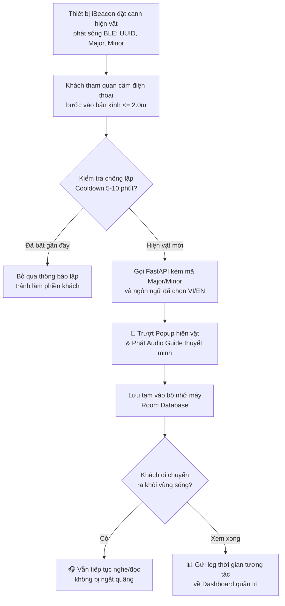
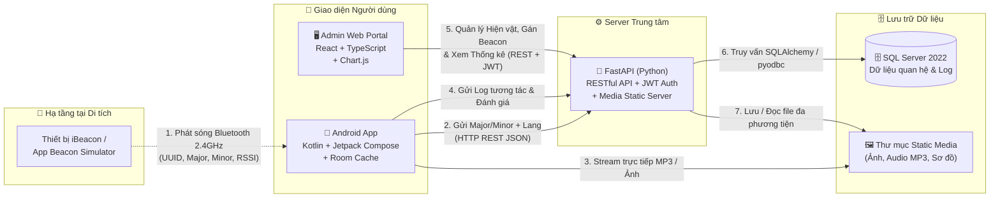
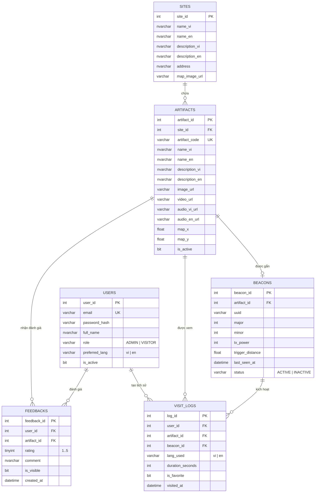
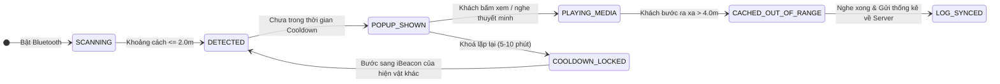

# 🏛️ Smart Heritage

> Hệ thống du lịch thông minh ứng dụng công nghệ **iBeacon (Bluetooth Low Energy)** giúp tự động nhận diện khoảng cách của khách tham quan với hiện vật lịch sử, phát thuyết minh đa ngôn ngữ và hỗ trợ ban quản lý số hóa, thống kê dữ liệu di tích.

-3DDC84)
-009688)


---

## 1. Vấn đề và hướng giải quyết

Tại nhiều bảo tàng và khu di tích lịch sử ở Việt Nam, việc tiếp cận thông tin hiện vật vẫn còn nhiều rào cản:

| Vấn đề | Hậu quả |
|---|---|
| Bảng thông tin tĩnh và chỉ có tiếng Việt | Khách tham quan (đặc biệt là khách quốc tế và giới trẻ) tiếp nhận thụ động, khó hiểu sâu câu chuyện lịch sử |
| Quét mã QR thủ công ở từng hiện vật | Làm đứt mạch cảm xúc tham quan, bất tiện khi thiếu sáng hoặc đông người |
| Ban quản lý thiếu công cụ số hóa và đo lường | Không biết hiện vật nào được quan tâm nhất, khách dùng ngôn ngữ nào hay thời gian dừng chân bao lâu |

**Smart Heritage loại bỏ thao tác quét mã thủ công.** Thay vào đó, luồng trải nghiệm tự động của hệ thống là:

```
Approach  →  Detect (BLE)  →  Resolve  →  Experience  →  Cache  →  Analyze
Tiếp cận     Bắt sóng iBeacon   Tra cứu     Nghe/Xem       Lưu tạm   Thống kê
hiện vật     dưới 2.0 mét       đa ngữ      thuyết minh    xem tiếp  lượt tương tác
```

### Luồng tự động nhận diện iBeacon và thuyết minh (điểm đặc trưng)



> Hệ thống **tự động chống lặp thông báo (Duplicate Prevention)**: Khi khách đứng yên ngắm một hiện vật, ứng dụng chỉ bật gợi ý một lần duy nhất và chỉ kích hoạt lại khi khách bước sang vùng phủ sóng của hiện vật khác.

---

## 2. Tính năng (phạm vi MVP trong 1 tháng)

| Nhóm | Chức năng |
|---|---|
| 👤 Tài khoản & Đa ngữ | Đăng ký / đăng nhập bằng email + password, chế độ **Khách vãng lai (Guest)** không cần đăng nhập, cập nhật hồ sơ, chọn ngôn ngữ thuyết minh (**Tiếng Việt / Tiếng Anh**), phân quyền `VISITOR` / `ADMIN` |
| 📡 Nhận diện iBeacon | Quét tín hiệu Bluetooth Low Energy (BLE) liên tục, ước lượng khoảng cách từ chỉ số RSSI, tự động bật **Bottom Sheet Popup** trong vòng $< 2\text{ s}$ khi cách hiện vật $\le 2.0\text{ m}$, chặn thông báo trùng lặp |
| 🎧 Đa phương tiện & Offline | Xem bài viết lịch sử, bộ sưu tập ảnh, video và trình phát **Audio Guide (`.mp3`)** theo ngôn ngữ đã chọn; tự động lưu đệm (Cache) để khách rời khỏi vùng sóng iBeacon vẫn nghe/đọc tiếp trọn vẹn |
| 🗺️ Bản đồ di tích | Hiển thị sơ đồ mặt bằng khu di tích với các điểm ghim (Pin) vị trí hiện vật; làm nổi bật vị trí hiện vật khách đang đứng gần; chạm vào ghim để xem thông tin |
| ❤️ Yêu thích & Lịch sử | Lưu hiện vật yêu thích (Favorites), xem lại nhật ký các hiện vật đã đi qua (Visit History) |
| ⭐ Đánh giá & Phản hồi | Chấm điểm $1\text{--}5$ sao và gửi nhận xét cho từng hiện vật; Admin kiểm duyệt (hiển thị / ẩn) phản hồi trên Web |
| 🛠️ Quản trị CMS & iBeacon | Quản lý khu di tích, thêm/sửa/xóa hiện vật đa ngôn ngữ, tải lên file ảnh/MP3/video; đăng ký mã iBeacon (`UUID`, `Major`, `Minor`), gán iBeacon vào hiện vật và chấm tọa độ $(X, Y)$ lên sơ đồ |
| 📊 Thống kê & Báo cáo | Dashboard trực quan hóa tổng lượt khách, biểu đồ Top hiện vật phổ biến, thời gian tương tác trung bình, tỷ lệ ngôn ngữ sử dụng và xuất báo cáo **Excel (`.xlsx`) / PDF** |

---

## 3. Kiến trúc tổng quan và cách các công nghệ kết nối



### Quy tắc kết nối giữa các thành phần (dễ nhớ)

> **iBeacon chỉ phát mã số qua Bluetooth $\rightarrow$ App Android bắt mã số đó hỏi FastAPI $\rightarrow$ FastAPI tra bảng SQL Server trả về nội dung và link thuyết minh MP3.**

| Việc cần làm | Đi đường nào | Vì sao |
|---|---|---|
| Phát tín hiệu vị trí hiện vật | `iBeacon` $\rightarrow$ `Android App` (qua sóng Bluetooth BLE) | Cục iBeacon chỉ phát quảng bá 1 chiều (`UUID`, `Major`, `Minor`), không cần mạng Internet |
| Biết cục iBeacon đó là hiện vật gì | `Android App` $\rightarrow$ `FastAPI` (`GET /api/beacons/resolve`) | App gửi `Major`, `Minor` và ngôn ngữ (`vi`/`en`) lên Server để lấy đúng bài viết, ảnh và link MP3 |
| Nghe thuyết minh & xem ảnh | `Android App` $\rightarrow$ `FastAPI Static Media` (`/static/...`) | Tải ảnh và phát trực tiếp (stream) file `.mp3` qua trình phát `ExoPlayer` |
| Xem tiếp khi đã đi xa hiện vật | `Android App` $\rightarrow$ `Room Database` (Bộ nhớ trong điện thoại) | Nội dung vừa mở được lưu tạm trên máy, mất sóng Bluetooth vẫn nghe tiếp đến hết bài |
| Ghi nhận lượt khách & thời gian xem | `Android App` $\rightarrow$ `FastAPI` (`POST /api/visit-logs`) | Khi khách rời hiện vật, App gửi số giây đã xem lên Server để cộng vào biểu đồ thống kê |
| Thêm hiện vật, tải MP3 & gán Beacon | `Admin Web` $\rightarrow$ `FastAPI` $\rightarrow$ `SQL Server` | Giúp ban quản lý cập nhật nội dung mới từ trình duyệt mà không cần sửa code ứng dụng di động |
| Xem biểu đồ & xuất báo cáo Excel/PDF | `Admin Web` $\rightarrow$ `FastAPI` (`GET /api/analytics/dashboard`) | Server tổng hợp dữ liệu bằng các câu lệnh `GROUP BY` từ SQL Server trả về cho Web vẽ biểu đồ |

---

## 4. Công nghệ sử dụng

### 📱 Mobile (Android)

| Mục đích | Công nghệ |
|---|---|
| Ngôn ngữ / Giao diện | Kotlin, Jetpack Compose, Material 3 |
| Kiến trúc | MVVM (`UI` $\rightarrow$ `ViewModel` $\rightarrow$ `Repository`), Kotlin Coroutines + StateFlow |
| Quét sóng iBeacon (BLE) | `Android Beacon Library (AltBeacon)` |
| Giả lập thiết bị phát iBeacon | Ứng dụng `Beacon Simulator` trên điện thoại Android phụ |
| Phát thuyết minh Audio / Video | `AndroidX Media3 (ExoPlayer)` |
| Lưu đệm xem ngoài vùng sóng | `Room Database (SQLite)` + `DataStore` (lưu ngôn ngữ & phiên đăng nhập) |
| Gọi REST API | `Retrofit2` + `OkHttp3` + `Gson / Kotlinx Serialization` |
| Hiển thị hình ảnh & sơ đồ | `Coil` |

### ⚙️ Backend (Python)

| Mục đích | Công nghệ |
|---|---|
| Framework API | `FastAPI` + `Uvicorn` (Tự động sinh tài liệu OpenAPI / Swagger tại `/docs`) |
| Kết nối Cơ sở dữ liệu | `SQLAlchemy 2.0` + `pyodbc` |
| Xác thực & Phân quyền | `JWT (PyJWT / python-jose)` + `passlib[bcrypt]` (Hash mật khẩu) + RBAC |
| Phục vụ file Ảnh / Audio MP3 | `FastAPI StaticFiles` (`multipart/form-data` upload) |
| Xuất báo cáo thống kê | `OpenPyXL` (xuất Excel `.xlsx`) |

### 🗄️ Cơ sở dữ liệu

| Mục đích | Công nghệ |
|---|---|
| Hệ quản trị CSDL | `Microsoft SQL Server 2022` |
| Công cụ quản trị & Thiết kế | `SQL Server Management Studio (SSMS)` |
| Tối ưu truy vấn thống kê | Indexing trên cặp `(major, minor)` và các hàm tổng hợp dữ liệu báo cáo |

### 🖥️ Admin Web

| Mục đích | Công nghệ |
|---|---|
| Framework | `React` + `Vite` + `TypeScript` |
| Thư viện giao diện CMS | `Ant Design` (Bảng dữ liệu, Tabs đa ngôn ngữ, Form Upload file) |
| Biểu đồ thống kê Dashboard | `Chart.js` / `Recharts` |
| Sơ đồ vị trí hiện vật & iBeacon | Bản đồ mặt bằng tương tác chấm tọa độ $(X, Y)$ |
| Gọi API | `Axios` |

---

## 5. Thiết kế cơ sở dữ liệu

Schema gồm **6 bảng cốt lõi** trong SQL Server, đảm bảo lưu trữ đầy đủ nội dung đa ngôn ngữ, cấu hình iBeacon và nhật ký tương tác của du khách.



### Trạng thái nhận diện iBeacon trên thiết bị di động



---

## 6. Cơ chế kỹ thuật & Bảo mật: những điểm chính

- **Lọc nhiễu tín hiệu BLE & Chống lặp thông báo:** Sóng Bluetooth rất dễ dao động; ứng dụng kết hợp kiểm tra ngưỡng khoảng cách kích hoạt (`trigger_distance` $\le 2.0\text{ m}$) và biến khóa thời gian (`Cooldown Timer`) để không bao giờ bật thông báo lặp lại làm phiền khách khi họ vẫn đứng tại cùng một hiện vật.
- **Xem liên tục ngoài vùng phủ sóng:** Ngay khi hiện vật được kích hoạt, nội dung văn bản và đường dẫn âm thanh được lưu vào `Room Database` trên điện thoại, giúp khách vừa đi dạo sang khu vực khác vừa nghe hết bài thuyết minh.
- **Tự động chuyển đổi đa ngôn ngữ:** Dựa trên cờ ngôn ngữ (`preferred_lang` = `vi` hoặc `en`) của khách, API tự động trả về tiêu đề, câu chuyện lịch sử và file âm thanh `.mp3` tương ứng.
- **Giám sát tình trạng iBeacon thụ động (Passive Telemetry):** Mỗi khi điện thoại của bất kỳ khách tham quan nào quét thấy iBeacon và gửi log lên Server, hệ thống tự động cập nhật cột `last_seen_at` của thiết bị đó để Admin biết thiết bị còn hoạt động hay đã hết pin.
- **Bảo mật & Phân quyền (RBAC):** Mật khẩu người dùng được mã hóa một chiều bằng `bcrypt`. Các API thêm/sửa/xóa hiện vật, cấu hình iBeacon và xuất báo cáo đều kiểm tra JWT Token với quyền `ADMIN`.

---

## 7. Giao diện (thiết kế Figma)

Thiết kế gồm **9 màn hình Mobile (`M1`–`M9`)** và **8 màn hình Web Admin (`W1`–`W8`)**:

| Nhóm màn hình | Nội dung |
|---|---|
| **Mobile: Khởi động & Tài khoản (`M1`, `M2`)** | Chọn ngôn ngữ (Việt / Anh), Đăng nhập, Đăng ký, hoặc nút **Tham quan ngay (Guest)** |
| **Mobile: Trang chủ & Rada BLE (`M3`, `M4`)** | Thanh trạng thái đang dò sóng iBeacon, danh sách hiện vật nổi bật, **Bottom Sheet Popup** tự động trượt lên khi đến gần hiện vật |
| **Mobile: Trải nghiệm Hiện vật (`M5`, `M7`)** | Hình ảnh hiện vật, trình phát **Audio Guide MP3** (Play/Pause/Tua), bài viết lịch sử, nút Thả tim và hộp thoại chấm sao đánh giá |
| **Mobile: Bản đồ & Cá nhân (`M6`, `M8`, `M9`)** | Bản đồ sơ đồ mặt bằng có chấm ghim vị trí hiện vật, Tab Yêu thích & Lịch sử đã xem, Cài đặt ngôn ngữ & bật/tắt thông báo BLE |
| **Admin Web: Quản trị CMS (`W1`, `W3`, `W4`)** | Đăng nhập Admin, Danh sách hiện vật, Form Thêm/Sửa hiện vật chia Tab Tiếng Việt / Tiếng Anh và tải file Ảnh + MP3 |
| **Admin Web: Hạ tầng iBeacon (`W5`, `W6`)** | Bảng đăng ký `UUID`, `Major`, `Minor`, gán iBeacon vào hiện vật, chấm tọa độ vị trí lên sơ đồ mặt bằng khu di tích |
| **Admin Web: Thống kê & Phản hồi (`W2`, `W7`, `W8`)** | 4 thẻ KPI tổng quan, 3 biểu đồ (Top hiện vật, Lượt khách theo ngày, Tỷ lệ ngôn ngữ), nút xuất Excel/PDF, trang duyệt bình luận và quản lý tài khoản |

---

## 8. Cấu trúc repository

```text
smart-heritage/
├── mobile/                  # Ứng dụng Android (Kotlin + Jetpack Compose)
│   └── app/src/main/java/com/smartheritage/
│       ├── ble/             # Bộ quét AltBeacon & lọc chống lặp thông báo
│       ├── data/            # Retrofit API client & Room Database (Offline Cache)
│       ├── ui/              # Các màn hình Compose (M1 -> M9) & ExoPlayer
│       └── viewmodel/       # Quản lý trạng thái giao diện
├── backend/                 # Server Python FastAPI
│   ├── app/
│   │   ├── routers/         # auth, sites, artifacts, beacons, analytics, feedbacks
│   │   ├── core/            # config, bảo mật JWT & RBAC
│   │   ├── models/          # SQLAlchemy ORM models (6 bảng)
│   │   └── schemas/         # Pydantic request/response schemas
│   ├── static/              # Lưu trữ file ảnh, sơ đồ và file âm thanh .mp3
│   └── main.py
├── admin-web/               # Cổng quản trị Web (React + Vite + TypeScript)
│   └── src/
│       ├── pages/           # Các trang quản trị W1 -> W8
│       ├── components/      # Biểu đồ Chart.js, Bản đồ sơ đồ, Upload form
│       └── services/        # Cấu hình Axios gọi FastAPI
├── database/
│   ├── init_schema.sql      # Script tạo 6 bảng SQL Server
│   └── seed_data.sql        # Dữ liệu mẫu 5 hiện vật lịch sử (Việt - Anh)
├── docs/                    # Báo cáo SRS/SDD, Biểu đồ PlantUML, Hướng dẫn sử dụng
└── README.md
```

---

## 9. Chạy thử dự án (tóm tắt)

1. **Cơ sở dữ liệu (SQL Server)**: Mở SSMS, chạy file `database/init_schema.sql` để tạo CSDL `SmartHeritageDB` và chạy `database/seed_data.sql` để nạp sẵn 5 hiện vật mẫu.
2. **Backend (FastAPI)**: `cd backend && python -m venv .venv && .venv\Scripts\activate && pip install -r requirements.txt`, cấu hình chuỗi kết nối SQL Server trong `.env`, chạy `uvicorn main:app --host 0.0.0.0 --port 8000 --reload` (mở `http://localhost:8000/docs` để xem Swagger).
3. **Admin Web**: `cd admin-web && npm install && npm run dev` để mở trang quản trị và Dashboard thống kê.
4. **Mobile & Giả lập iBeacon**: Mở thư mục `mobile/` bằng Android Studio, điền địa chỉ IP LAN của laptop vào `ApiClient.kt` rồi chạy lên Điện thoại 1. Trên Điện thoại 2, mở ứng dụng **Beacon Simulator**, bật cấu hình `Major = 1, Minor = 101` và đặt gần Điện thoại 1 để trải nghiệm tự động bật thuyết minh.

---

## 10. Lộ trình (Hoàn thành trong 1 tháng - 30 ngày)

- [ ] **M0** Nền tảng (Ngày 1–3): Khởi tạo repo, thiết kế Figma, tạo CSDL SQL Server, chuẩn bị dữ liệu mẫu (Ảnh/MP3) & khung FastAPI
- [ ] **M1** Tài khoản & Đa ngôn ngữ (Ngày 4–6): Đăng ký, đăng nhập, chế độ Khách (Guest), chọn ngôn ngữ (Việt/Anh), phân quyền Admin/Visitor
- [ ] **M2** Quản trị nội dung CMS (Ngày 7–10): Quản lý khu di tích, thêm/sửa/xóa hiện vật đa ngôn ngữ, upload ảnh & file thuyết minh MP3
- [ ] **M3** Hạ tầng iBeacon (Ngày 11–13): Đăng ký thiết bị iBeacon (`UUID`, `Major`, `Minor`), gán vào hiện vật, cấu hình bán kính & tọa độ sơ đồ
- [ ] **M4** Nhận diện iBeacon tự động (Ngày 14–18): Tích hợp quét sóng BLE trên Mobile, lọc khoảng cách $\le 2.0\text{ m}$, chống lặp thông báo & tự bật Popup
- [ ] **M5** Trải nghiệm Đa phương tiện & Bản đồ (Ngày 19–22): Trình phát Audio Guide/Video, lưu tạm xem tiếp ngoài vùng sóng (Cache) & bản đồ sơ đồ di tích
- [ ] **M6** Tương tác khách tham quan (Ngày 23–25): Lưu hiện vật yêu thích (Favorites), nhật ký lịch sử tham quan (Visit History), chấm sao & gửi đánh giá
- [ ] **M7** Thống kê & Quản trị nâng cao (Ngày 26–28): Dashboard biểu đồ lượt khách, Top hiện vật, ngôn ngữ, kiểm duyệt đánh giá & xuất báo cáo Excel/PDF
- [ ] **M8** Phát hành, Tài liệu & Demo (Ngày 29–30): Đồng bộ toàn hệ thống, hoàn thiện báo cáo Word (SRS/SDD), hướng dẫn sử dụng & quay video demo

---

## 11. Nhóm thực hiện

| Thành viên | Vai trò chính |
|---|---|
| Thành viên 1 (Leader) | Thiết kế CSDL SQL Server, phát triển Backend FastAPI & tích hợp hệ thống |
| Thành viên 2 | Phát triển ứng dụng di động Android (Kotlin, Jetpack Compose, Quét sóng BLE iBeacon) |
| Thành viên 3 | Phát triển Web Admin CMS (Quản lý di tích, hiện vật đa ngôn ngữ & cấu hình iBeacon) |
| Thành viên 4 | Phát triển Dashboard Thống kê, Biểu đồ báo cáo, Xuất Excel/PDF & Quản lý phản hồi |
| Thành viên 5 | Thiết kế giao diện Figma, chuẩn bị Dữ liệu mẫu (Việt/Anh, Audio MP3) & Tài liệu báo cáo |